<picture>
  <source media="(prefers-color-scheme: dark)" srcset="https://raw.githubusercontent.com/Team-Stier/.github/main/assets/logo-white.png" />
  <source media="(prefers-color-scheme: light)" srcset="https://raw.githubusercontent.com/Team-Stier/.github/main/assets/logo-black.png" />
  
</picture>

<!-- GitHub strips CSS, so these breaks push the text down beside the floated logo -->

         
  Autonomous Vehicle &amp; Robotics development club Hongik University, Seoul, South Korea

  
  
  
   
  
  

## 🐂 About

**Team STIER**는 홍익대학교 자율주행차 동아리입니다. 인지, 판단, 제어 자율주행 ROS 스택을 개발하고 1/5 스케일 차량 및 시뮬레이터 대회에 출전합니다.

2026년에는 5개 대회 6개 부문에 출전해 6개의 상을 받았습니다. 대회 밖에서는 DiffusionDrive, Alpamayo-R1 같은 End-to-End 자율주행 모델도 함께 공부합니다.

2027년에는 자율주행과 더불어 로보틱스로 분야를 확장해 운영할 계획입니다.

## 🏆 Awards & Achievements

| 대회 | 수상 | 수여일 |
|---|---|---|
| **HL Mando Future Mobility Award 2026** · 1/5 부문 | 🏅 완주상 (STIER 1팀, STIER 2팀) | 2026.10.30 |
| **HL Mando Future Mobility Award 2026** · 시뮬레이션 부문 | 🏅 장려상 (STIER 1팀, 오뒷세이) | 2026.10.30 |
| **제5회 국제 대학생 EV 자율주행 경진대회** · 1/5 부문 | 🏅 혁신상, 장려상 | 2026.03.27 |

<table>
  <tr>
    <td width="33%" align="center"> HL 1/5 완주상 · STIER 1팀</td>
    <td width="33%" align="center">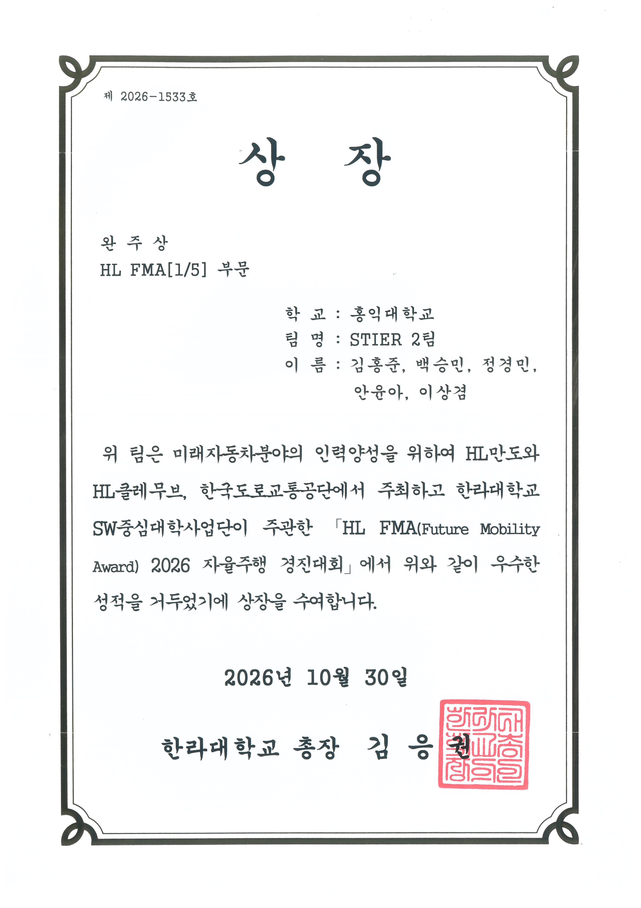 HL 1/5 완주상 · STIER 2팀</td>
    <td width="33%" align="center">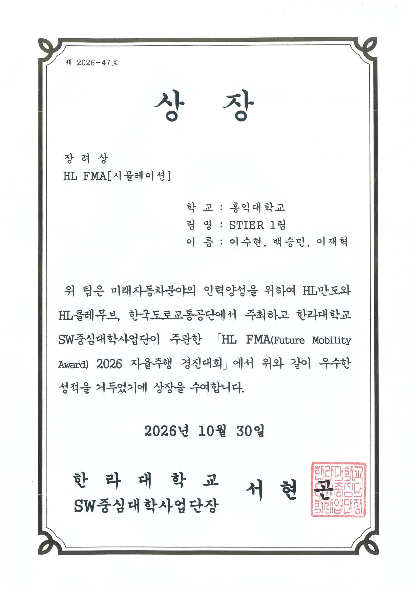 HL 시뮬레이션 장려상 · STIER 1팀</td>
  </tr>
  <tr>
    <td width="33%" align="center">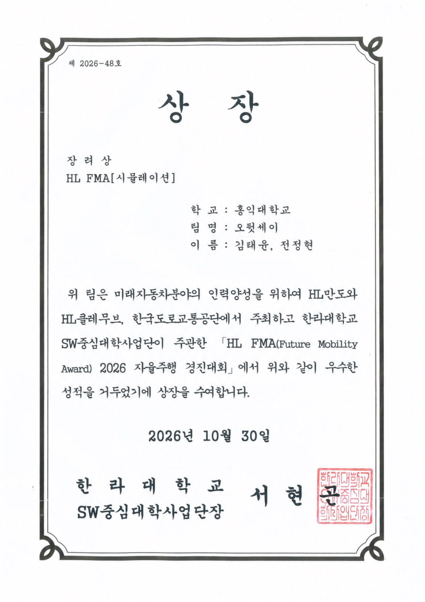 HL 시뮬레이션 장려상 · 오뒷세이</td>
    <td width="33%" align="center">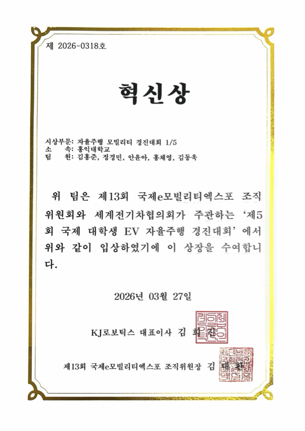 EV 경진대회 혁신상</td>
    <td width="33%" align="center"> EV 경진대회 장려상</td>
  </tr>
</table>

## 🏁 Activities

2026년에 직접 만들고 달린 여섯 번의 출전 기록입니다.

<table>
  <tr>
    <td width="50%" valign="top">
      <a href="https://github.com/Team-Stier/MORAI-Autonomous-Driving-System">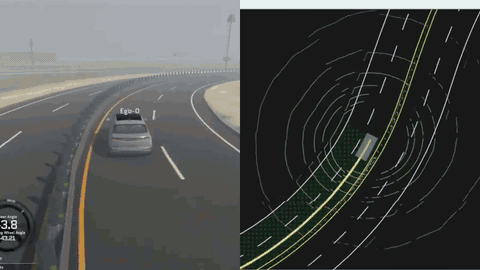</a>
       <b>2026 대학생 AI·S/W 모빌리티 경진대회</b>
       2026.10 · 화성 자동차안전연구원 · 본선 2개 팀 출전
        가상의 아이오닉5로 화성시의 자율주행 시험장 K-City를 달립니다. 정·동적 장애물, 신호등, 로타리·고속도로 끼어들기, GPS음영 등의 미션을 수행합니다.
        <code>ROS Noetic</code> <code>C++</code> <code>Hybrid A*</code> <code>MPC</code> <code>YOLO</code>
        <a href="https://github.com/Team-Stier/MORAI-Autonomous-Driving-System">Repo</a> · <a href="https://github.com/Team-Stier/MORAI-UDP-Bridge-Node">UDP Bridge</a>
    </td>
    <td width="50%" valign="top">
      <a href="https://github.com/Team-Stier/HL-FMA-1-5-2026">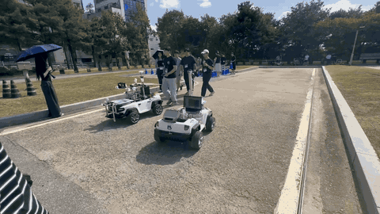</a>
       <b>HL Mando FMA 2026 · 1/5 부문</b>
       2026.09 · 용인운전면허시험장 · 🏅 완주상 2팀
        용인운전면허시험장에서 실제 대형 면허시험을 통과해야 하는 실차 대회입니다. 두 팀 모두 완주상을 수상하였습니다.
        <code>ROS Noetic</code> <code>EKF</code> <code>YOLO</code> <code>DBSCAN</code> <code>Pure Pursuit</code>
        <a href="https://github.com/Team-Stier/HL-FMA-1-5-2026">Repo</a>
    </td>
  </tr>
  <tr>
    <td width="50%" valign="top">
      <a href="https://github.com/Team-Stier/HL-FMA2026-sim-stier">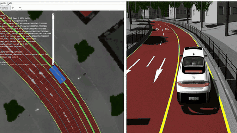</a>
       <b>HL Mando FMA 2026 · 시뮬레이션 부문</b>
       2026.09 · VTD 시뮬레이터 · 🏅 장려상 2팀
        VTD 시뮬레이터 환경에서 주행하는 특권모델을 개발하였습니다. 두 팀 모두 장려상을 수상하였습니다.
        <code>ROS 2 Jazzy</code> <code>C++</code> <code>Lanelet2</code> <code>R-tree</code>
        <a href="https://github.com/Team-Stier/HL-FMA2026-sim-stier">Repo</a>
    </td>
    <td width="50%" valign="top">
      <a href="https://github.com/Team-Stier/AMET2026_coex_stier">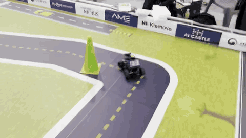</a>
       <b>2026 AMET 자율주행 해커톤</b>
       2026.08 · 코엑스
        무박 2일의 시간동안 트랙에서 소형 차로 정적 장애물 회피, 신호등 인식 미션을 개발합니다. 랩타임을 겨루는 대회인 만큼 최적의 인코스 주행이 가능한 SW를 개발하였습니다.
        <code>ROS 2 Jazzy</code> <code>Python</code> <code>Hybrid A*</code> <code>YOLO</code>
        <a href="https://github.com/Team-Stier/AMET2026_coex_stier">Repo</a>
    </td>
  </tr>
  <tr>
    <td width="50%" valign="top">
      <a href="https://github.com/Team-Stier/kookmin-Stier1-src">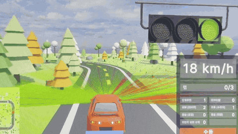</a>
       <b>국민대 자율주행 대회</b>
       2026.06 · Kookmin SIM
        라바콘을 피하고, 신호를 읽고, 라이다로 경찰차를 알아보는 차를 만들었습니다. 센서 데이터가 제한된 환경에서 최선의 주행을 완성하였습니다.
        <code>ROS 2</code> <code>YOLO11n</code> <code>OpenCV</code> <code>State Machine</code> <code>Stanley</code>
        <a href="https://github.com/Team-Stier/kookmin-Stier1-src">Repo</a>
    </td>
    <td width="50%" valign="top">
      <a href="https://github.com/Team-Stier/JEJU-ROS-autonomous-vehicle">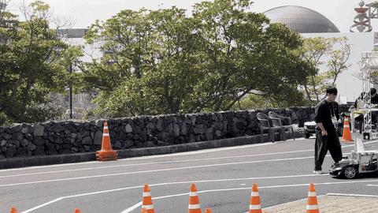</a>
       <b>제5회 국제 대학생 EV 자율주행 경진대회</b>
       2026.03 · 제주 · 🏅 혁신상, 장려상
        제주에서 열린 국제 대학생 대회입니다. 1/5 스케일 차량이 라바콘 사이를 주행하거나 차선을 인식해 주행합니다. Generator-Selector 구조로 안정적인 스택을 개발하여 장려상과 혁신상을 수상하였습니다.
        <code>ROS 1</code> <code>RRT*</code> <code>Pure Pursuit</code> <code>VLP-16</code> <code>RTK-GNSS</code>
        <a href="https://github.com/Team-Stier/JEJU-ROS-autonomous-vehicle">Repo</a>
    </td>
  </tr>
</table>

## 🛠 Tech Stack

<table>
  <tr>
    <td><b>Language</b></td>
    <td>
      
      
      
      
    </td>
  </tr>
  <tr>
    <td><b>Platform</b></td>
    <td>
      
      
      
      
    </td>
  </tr>
  <tr>
    <td><b>ML</b></td>
    <td>
      
      
      
    </td>
  </tr>
  <tr>
    <td><b>Simulator</b></td>
    <td>
      
      
    </td>
  </tr>
  <tr>
    <td><b>Visualization</b></td>
    <td>
      
      
      
      
    </td>
  </tr>
  <tr>
    <td><b>Perception</b></td>
    <td>
      
      
      
      
      
    </td>
  </tr>
  <tr>
    <td><b>Localization</b></td>
    <td>
      
      
    </td>
  </tr>
  <tr>
    <td><b>Planning</b></td>
    <td>
      
      
      
      
    </td>
  </tr>
  <tr>
    <td><b>Control</b></td>
    <td>
      
      
      
    </td>
  </tr>
  <tr>
    <td><b>Hardware</b></td>
    <td>
      
      
      
      
      
    </td>
  </tr>
  <tr>
    <td><b>CAD</b></td>
    <td>
      
      
    </td>
  </tr>
</table>

## 👥 Members

### 2026

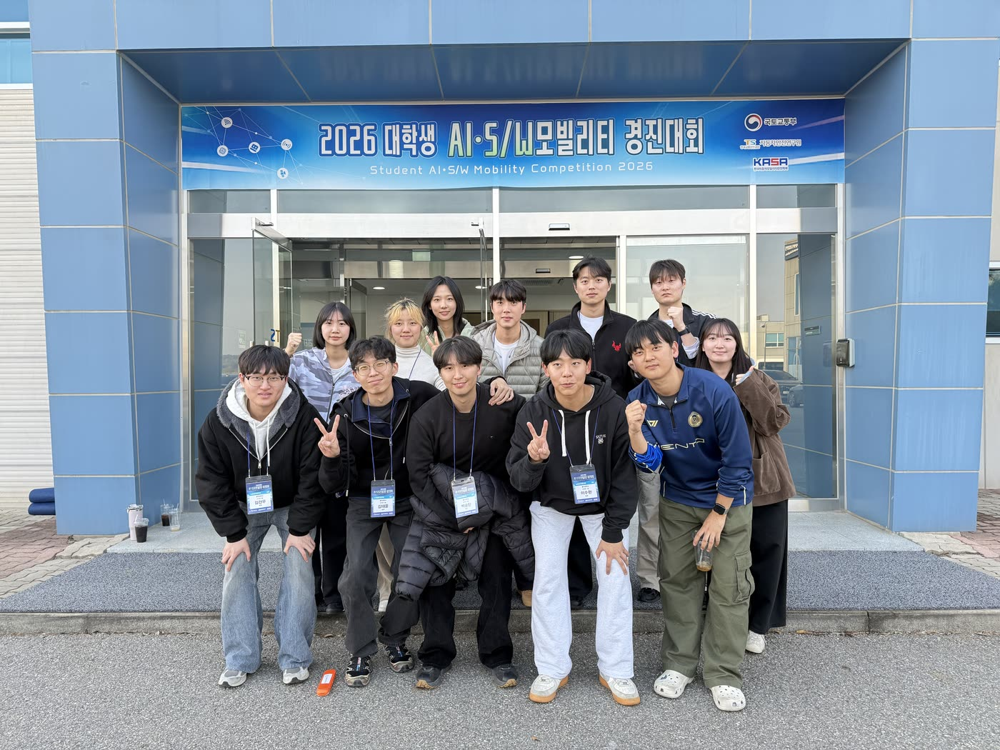

<table>
  <tr>
    <td align="center" valign="top" width="16%"><a href="https://github.com/simonpaik04"> simonpaik04</a></td>
    <td align="center" valign="top" width="16%"><a href="https://github.com/TaeYun240203"> TaeYun240203</a></td>
    <td align="center" valign="top" width="16%"><a href="https://github.com/kmtommy"> kmtommy</a></td>
    <td align="center" valign="top" width="16%"><a href="https://github.com/chae-collab"> chae-collab</a></td>
    <td align="center" valign="top" width="16%"><a href="https://github.com/choialsgh08-hash"> choialsgh08-hash</a></td>
    <td align="center" valign="top" width="16%"><a href="https://github.com/cjhyun123"> cjhyun123</a></td>
  </tr>
  <tr>
    <td align="center" valign="top"><a href="https://github.com/dwk0714"> dwk0714</a></td>
    <td align="center" valign="top"><a href="https://github.com/EngineeringKIM"> EngineeringKIM</a></td>
    <td align="center" valign="top"><a href="https://github.com/Heewon-Kwon03"> Heewon-Kwon03</a></td>
    <td align="center" valign="top"><a href="https://github.com/jaehyeok012"> jaehyeok012</a></td>
    <td align="center" valign="top"><a href="https://github.com/JJOon-maker"> JJOon-maker</a></td>
    <td align="center" valign="top"><a href="https://github.com/khjhank-maker"> khjhank-maker</a></td>
  </tr>
  <tr>
    <td align="center" valign="top"><a href="https://github.com/LeeTak11"> LeeTak11</a></td>
    <td align="center" valign="top"><a href="https://github.com/SSING-rloz"> SSING-rloz</a></td>
    <td align="center" valign="top"><a href="https://github.com/starryeev"> starryeev</a></td>
    <td align="center" valign="top"><a href="https://github.com/suhyeon-01004"> suhyeon-01004</a></td>
    <td align="center" valign="top"><a href="https://github.com/yoonah620-ahn"> yoonah620-ahn</a></td>
  </tr>
</table>

### 2027

자율주행 및 로보틱스, 피지컬AI에 관심이 있는 기계공학과, 컴퓨터공학과, 전기전자공학과 2,3학년 예정자를 기다립니다. 궁금한 점은 [simonpaik04@gmail.com](mailto:simonpaik04@gmail.com)으로 물어보세요.
